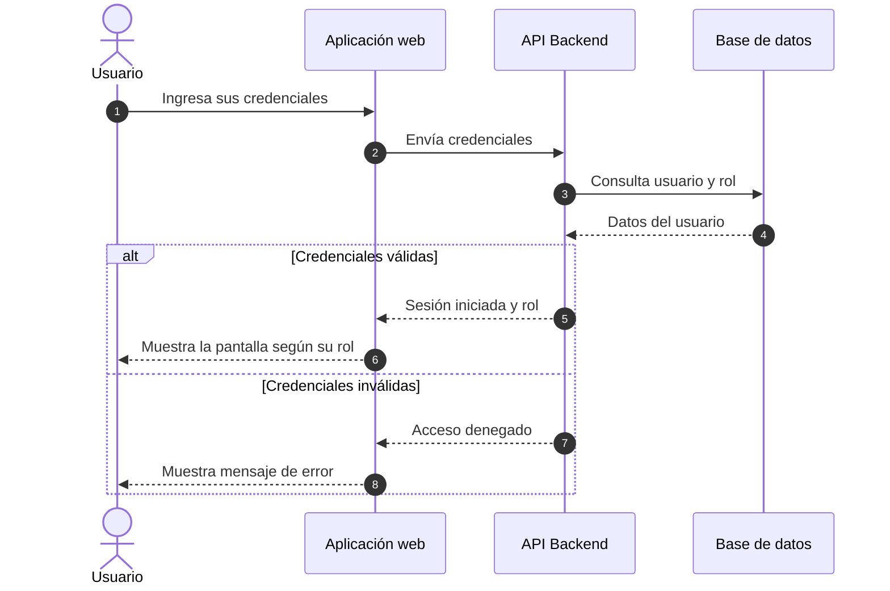
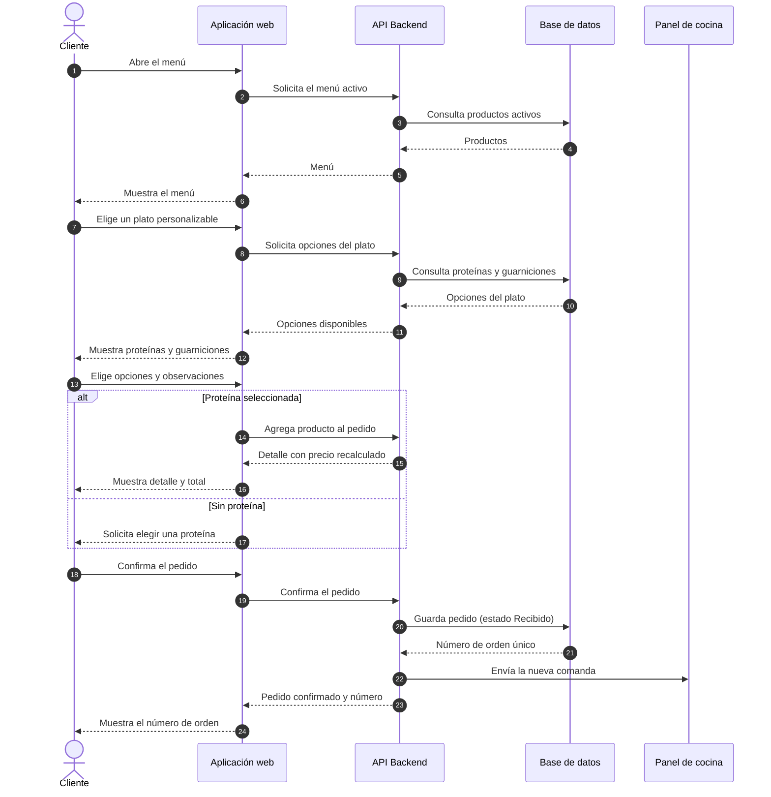
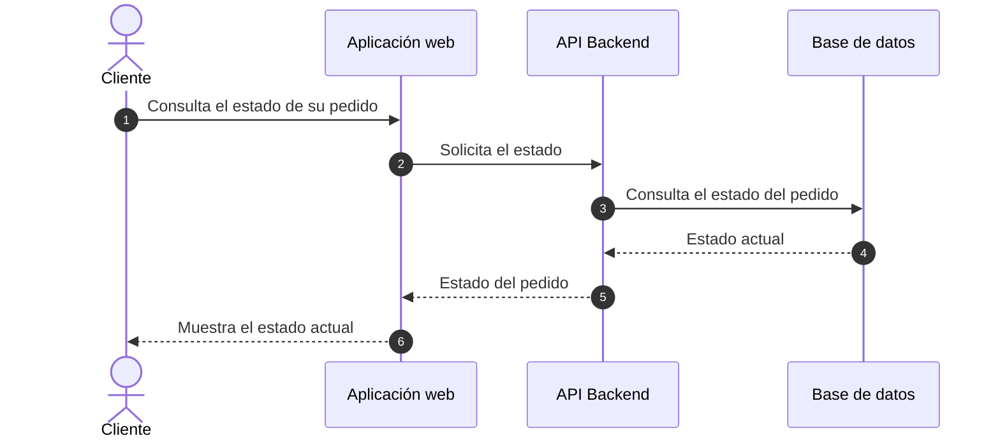
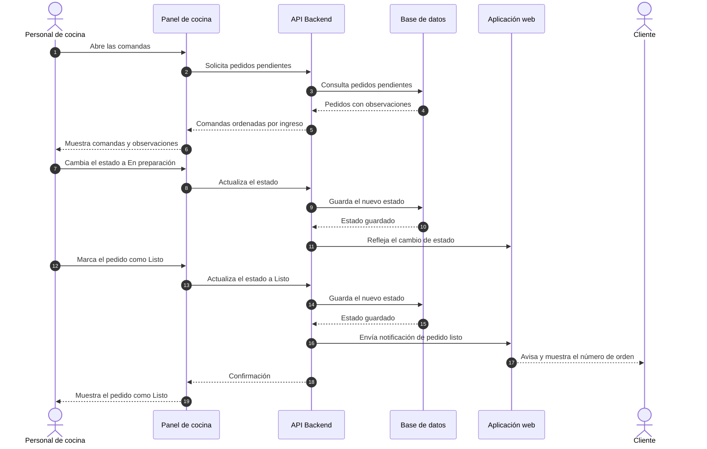
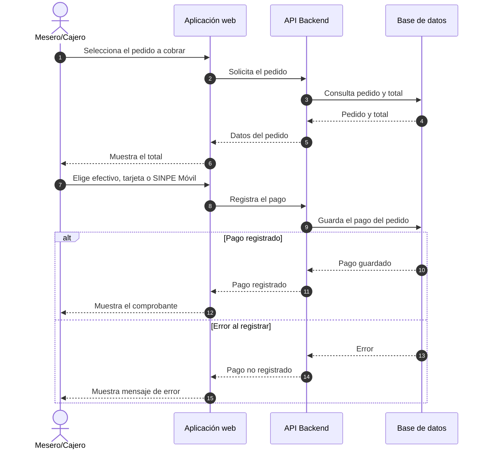
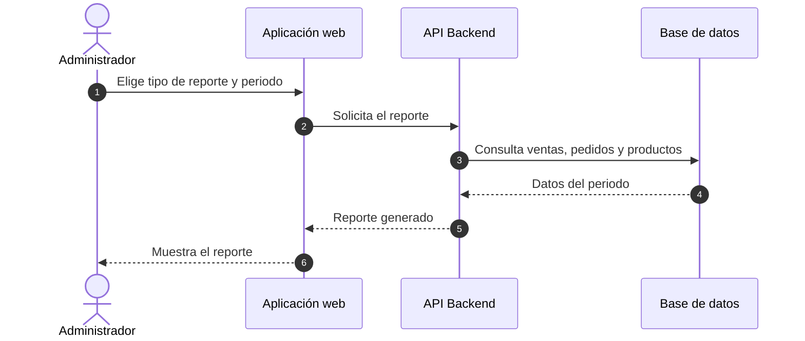

# Diagramas de Secuencia - Sistema Soda

Los participantes corresponden a los componentes de la arquitectura: Aplicación web, Panel de cocina, API Backend y Base de datos. Cada diagrama indica los requerimientos funcionales (RF) que cubre, según `docs/01-requisitos/requisitos.md`.

| # | Diagrama | Actor | Requerimientos |
|---|---|---|---|
| 1 | Iniciar sesión | Usuario (cualquier rol) | RF-20 |
| 2 | Realizar pedido | Cliente | RF-02 a RF-08, RF-18 |
| 3 | Consultar estado del pedido | Cliente | RF-09, RF-11 |
| 4 | Preparar pedido y notificar | Personal de cocina | RF-10 a RF-14, RF-17, RF-25 |
| 5 | Registrar pago | Mesero/Cajero | RF-15, RF-16 |
| 6 | Generar reportes | Administrador | RF-23, RF-24 |

## 1. Iniciar sesión (RF-20)

## 2. Realizar pedido (RF-02 a RF-08, RF-18)

## 3. Consultar estado del pedido (RF-09, RF-11)

Estados posibles: Recibido, En preparación, Listo, Entregado y Cancelado (RF-10).

## 4. Preparar pedido y notificar (RF-10 a RF-14, RF-17, RF-25)

## 5. Registrar pago (RF-15, RF-16)

## 6. Generar reportes (RF-23, RF-24)

