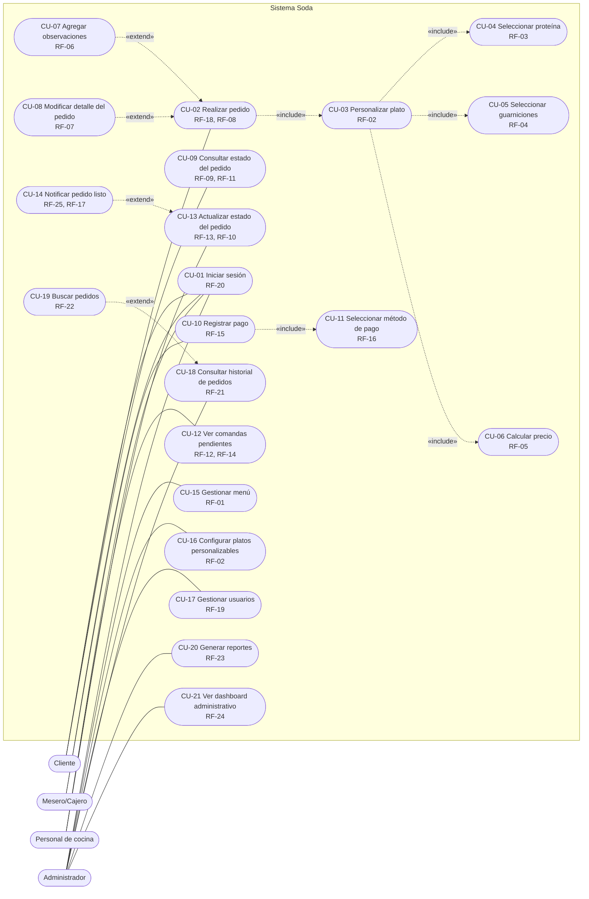

# Diagrama de Casos de Uso - Sistema Soda

## Descripción

Este diagrama muestra las funcionalidades del Sistema Soda y los actores que interactúan con ellas. Cada caso de uso se deriva de los requerimientos funcionales de `docs/01-requisitos/requisitos.md` y se identifica con su RF (por ejemplo, RF-03).

## Actores

| Actor | Descripción | Casos de uso principales |
|---|---|---|
| Cliente | Realiza sus pedidos de forma autónoma y consulta su estado. | CU-02, CU-09 |
| Mesero/Cajero | Registra los pagos de los pedidos. | CU-10 |
| Personal de cocina | Visualiza las comandas y actualiza el estado de los pedidos. | CU-12, CU-13 |
| Administrador | Gestiona el menú, los usuarios, el historial, los reportes y el dashboard. | CU-15 a CU-18, CU-20, CU-21 |

Todos los actores inician sesión (CU-01).

## Diagrama

## Trazabilidad con los requerimientos funcionales

| RF | Requerimiento | Caso(s) de uso |
|---|---|---|
| RF-01 | Gestión de menú | CU-15 |
| RF-02 | Configuración de platos | CU-03, CU-16 |
| RF-03 | Selección de proteína | CU-04 |
| RF-04 | Selección de guarniciones | CU-05 |
| RF-05 | Cálculo automático de precio | CU-06 |
| RF-06 | Observaciones del pedido | CU-07 |
| RF-07 | Detalles de órdenes | CU-08 |
| RF-08 | Generación de órdenes | CU-02 |
| RF-09 | Consulta de estado | CU-09 |
| RF-10 | Gestión de estados | CU-13 |
| RF-11 | Actualización en tiempo real | CU-09, CU-13 |
| RF-12 | Gestión de comandas | CU-12 |
| RF-13 | Cambio de estado por cocina | CU-13 |
| RF-14 | Visualización de observaciones | CU-12 |
| RF-15 | Registro de pagos | CU-10 |
| RF-16 | Métodos de pago | CU-11 |
| RF-17 | Pedidos para recoger | CU-14 |
| RF-18 | Autogestión de clientes | CU-02 |
| RF-19 | Gestión de usuarios | CU-17 |
| RF-20 | Inicio de sesión | CU-01 |
| RF-21 | Historial de pedidos | CU-18 |
| RF-22 | Búsqueda de pedidos | CU-19 |
| RF-23 | Reportes administrativos | CU-20 |
| RF-24 | Dashboard administrativo | CU-21 |
| RF-25 | Notificaciones | CU-14 |

## Descripción de los casos de uso principales

### CU-01: Iniciar sesión

| Campo | Detalle |
|---|---|
| Actor | Cliente, Mesero/Cajero, Personal de cocina, Administrador |
| Requerimiento | RF-20 |
| Precondición | El usuario tiene una cuenta con un rol asignado. |
| Flujo principal | 1. El usuario ingresa sus credenciales. 2. El sistema las valida. 3. El sistema abre la sesión y muestra la pantalla correspondiente a su rol. |
| Flujo alterno | Si las credenciales no son válidas, el sistema niega el acceso y muestra un mensaje de error. |
| Postcondición | El usuario queda autenticado y solo accede a las funciones de su rol. |

### CU-02: Realizar pedido

| Campo | Detalle |
|---|---|
| Actor | Cliente |
| Requerimientos | RF-18, RF-08 (y RF-02 a RF-07 mediante los casos incluidos y extendidos) |
| Precondición | El cliente ha iniciado sesión y el menú tiene productos activos. |
| Flujo principal | 1. El cliente consulta el menú. 2. Elige un plato y lo personaliza (CU-03): selecciona la proteína (CU-04) y las guarniciones incluidas y adicionales (CU-05). 3. El sistema actualiza el precio con los extras (CU-06). 4. El cliente confirma el pedido. 5. El sistema genera un número de orden único con estado Recibido y envía la comanda a cocina. |
| Flujos alternos | Si el cliente no elige proteína en un casado, el sistema no permite agregarlo. Antes de confirmar puede agregar observaciones (CU-07) y agregar, modificar o eliminar productos (CU-08). |
| Postcondición | El pedido queda registrado con su número de orden y visible en el panel de cocina. |

### CU-09: Consultar estado del pedido

| Campo | Detalle |
|---|---|
| Actor | Cliente |
| Requerimientos | RF-09, RF-11 |
| Precondición | El cliente tiene un pedido registrado. |
| Flujo principal | 1. El cliente consulta su pedido. 2. El sistema muestra el estado actual: Recibido, En preparación, Listo, Entregado o Cancelado. |
| Postcondición | El cliente conoce el estado actualizado de su pedido (los cambios se reflejan en un máximo de 5 segundos). |

### CU-10: Registrar pago

| Campo | Detalle |
|---|---|
| Actor | Mesero/Cajero |
| Requerimientos | RF-15, RF-16 |
| Precondición | Existe un pedido pendiente de pago. |
| Flujo principal | 1. El cajero selecciona el pedido. 2. Elige el método de pago: efectivo, tarjeta o SINPE Móvil (CU-11). 3. El sistema registra el pago asociado al pedido. |
| Flujo alterno | Si el pago no se puede registrar, el sistema muestra un error y el pedido sigue pendiente de pago. |
| Postcondición | El pago queda asociado al pedido. |

### CU-13: Actualizar estado del pedido

| Campo | Detalle |
|---|---|
| Actor | Personal de cocina |
| Requerimientos | RF-13, RF-10 (y RF-25, RF-17 mediante CU-14) |
| Precondición | Hay pedidos pendientes en las comandas (CU-12). |
| Flujo principal | 1. La cocina selecciona un pedido. 2. Cambia su estado (por ejemplo, de Recibido a En preparación y luego a Listo). 3. El sistema guarda el cambio y lo refleja para clientes y colaboradores. |
| Extensión | Cuando el estado pasa a Listo, el sistema notifica al cliente y muestra el número de orden para retirar el pedido (CU-14). |
| Postcondición | El pedido queda con su nuevo estado. |

### CU-18 y CU-19: Historial y búsqueda de pedidos

| Campo | Detalle |
|---|---|
| Actor | Administrador |
| Requerimientos | RF-21, RF-22 |
| Flujo principal | El administrador consulta el historial de pedidos (CU-18). Opcionalmente busca por número de orden, fecha, cliente o estado (CU-19). |

## Puntos por confirmar con el equipo

- **Mesero/Cajero:** los requerimientos no indican quién registra los pagos. Se asumió este rol; si no existe, el CU-10 lo haría otro actor.
- **Búsqueda de pedidos (CU-19):** se asignó al Administrador; ajustar si también la usa el personal de caja.
