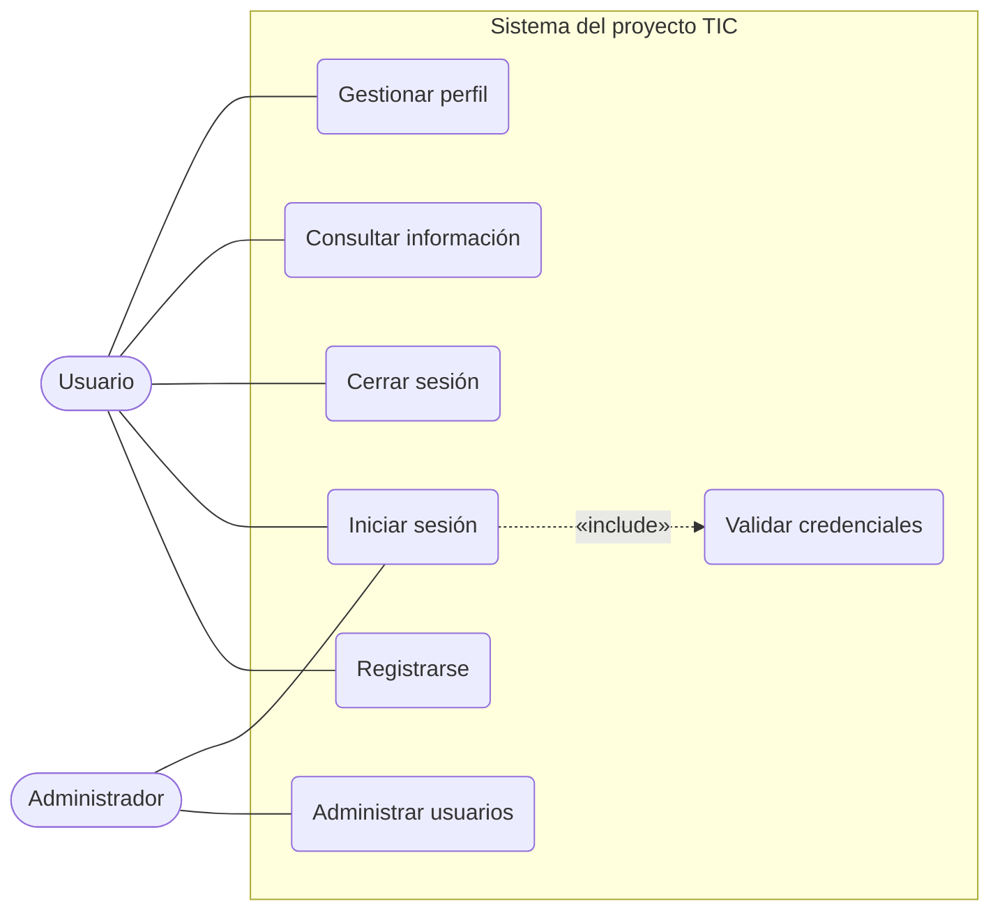

# Diagrama de Casos de Uso

## Descripción

Este diagrama muestra las funcionalidades principales del sistema y los actores que interactúan con ellas.

## Actores

| Actor | Descripción |
|---|---|
| Usuario | Persona registrada que usa las funciones del sistema. |
| Administrador | Usuario con permisos para gestionar otros usuarios y la configuración. |

## Diagrama

## Descripción de casos de uso principales

### CU-01: Iniciar sesión

| Campo | Detalle |
|---|---|
| Actor | Usuario, Administrador |
| Precondición | La cuenta ya está registrada. |
| Flujo principal | 1. El usuario ingresa correo y contraseña. 2. El sistema valida las credenciales. 3. El sistema entrega un token de sesión. 4. El sistema muestra la pantalla principal. |
| Flujo alterno | Si las credenciales son incorrectas, el sistema muestra un mensaje de error. |
| Postcondición | El usuario queda autenticado. |

### CU-02: Registrarse

| Campo | Detalle |
|---|---|
| Actor | Usuario |
| Precondición | El correo no está registrado. |
| Flujo principal | 1. El usuario completa el formulario. 2. El sistema valida los datos. 3. El sistema crea la cuenta. |
| Flujo alterno | Si el correo ya existe, el sistema informa el error. |
| Postcondición | La cuenta queda creada. |

> **Nota:** ajustar los casos de uso 4 a 6 a las funcionalidades reales del proyecto (ver `requisitos.md`).
