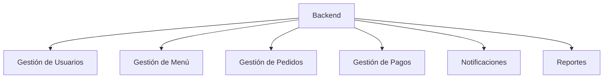

# C4 - Nivel 3 - Componentes

## Objetivo

Mostrar los componentes internos del Backend.

## Componentes

### Gestión de Usuarios

- Login
- Roles
- Permisos

### Gestión de Menú

- Productos
- Categorías
- Activación y desactivación

### Gestión de Pedidos

- Carrito
- Estados
- Historial

### Gestión de Pagos

- Efectivo
- Tarjeta
- SINPE

### Notificaciones

- Pedido listo
- Cambios de estado

### Reportes

- Ventas
- Productos vendidos
- Indicadores de negocio