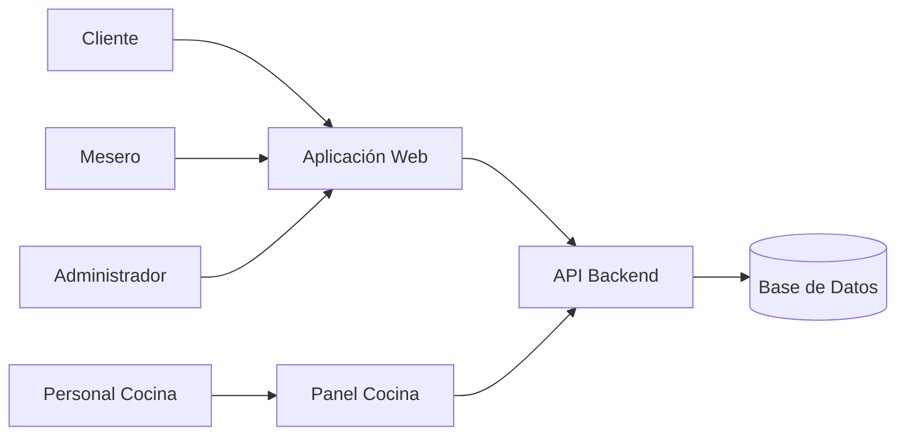

# C4 - Nivel 2 - Diagrama de Contenedores

## Objetivo

Mostrar los principales contenedores del sistema y sus relaciones.

## Contenedores

### Aplicación Web

Responsable de:

- Autenticación
- Gestión de pedidos
- Carrito de compras
- Consulta de estados

### Panel Cocina

Responsable de:

- Visualizar comandas
- Actualizar estados

### API Backend

Responsable de:

- Lógica de negocio
- Seguridad
- Integración con base de datos

### Base de Datos

Almacena:

- Usuarios
- Productos
- Pedidos
- Pagos
- Reportes