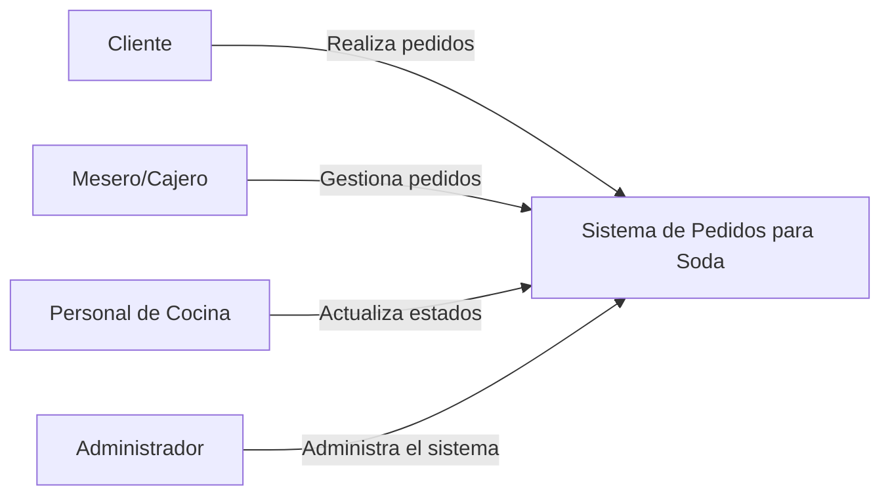

# C4 - Nivel 1 - Diagrama de Contexto

## Objetivo

Mostrar cómo interactúan los actores principales con el sistema.

## Actores

### Cliente
- Realiza pedidos.
- Consulta el estado de órdenes.
- Recibe notificaciones.

### Mesero / Cajero
- Gestiona órdenes.
- Registra pagos.

### Personal de Cocina
- Consulta comandas.
- Actualiza estados.

### Administrador
- Gestiona productos.
- Consulta reportes.
- Administra usuarios.