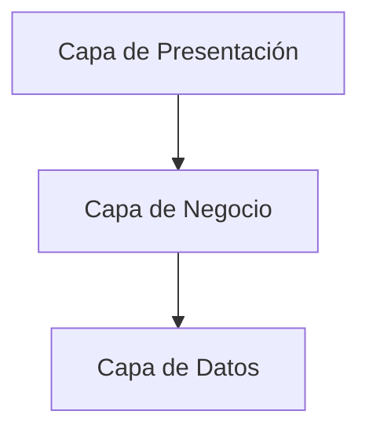

# Arquitectura del Software

## Estilo Arquitectónico

Se utilizará una arquitectura de tres capas.

## Capa de Presentación

Responsable de:

- Interfaces de usuario
- Formularios
- Visualización de órdenes

---

## Capa de Negocio

Responsable de:

- Reglas de negocio
- Validaciones
- Procesamiento de pedidos

---

## Capa de Datos

Responsable de:

- Persistencia
- Consultas
- Integridad de información

---

## Beneficios

- Escalabilidad
- Modularidad
- Reutilización
- Mantenimiento sencillo